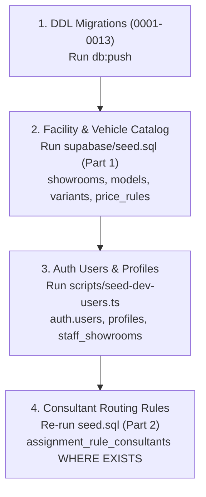

# VROOMA — FINAL BLOCKER VERIFICATION REPORT (READ-ONLY)

> **Document Reference:** VERIF-PHASE2-BLOCKERS-01  
> **Date:** November 2026  
> **Auditor Role:** Principal Backend Architect, PostgreSQL Security Specialist, Supabase CLI & Platform Auditor  
> **Target DEV Project:** `eobtzcwinjmimzisypca`  
> **Production Project:** `ajumkjokagqfdikfguti` (STRICTLY PRESERVED & UNTOUCHED)  
> **Deleted Project:** `gmyrehlrmifxckszrdje` (VERIFIED REJECTED)  
> **Verification Status:** COMPLETED (STRICTLY READ-ONLY)

---

## 1. SUPABASE CLI COMPATIBILITY & MIGRATION RUNNER VERIFICATION

### 1.1 Installed Supabase CLI Version

The Supabase CLI executable currently installed and invoked in this environment was forensically verified via direct command-line execution:

- **Installed CLI Binary:** `C:\Users\saaar\AppData\Local\npm-cache\_npx\aa8e5c70f9d8d161\node_modules\@supabase\cli-windows-x64\bin\supabase.exe`
- **CLI Package Definition:** `C:\Users\saaar\AppData\Local\npm-cache\_npx\aa8e5c70f9d8d161\node_modules\supabase\package.json`
- **Exact Installed Version:** **`3.0.0`**
- **Runtime Engine:** Bun v1.4.4 (Windows x64), Effect Platform Bun 4.0.2

### 1.2 Inspection of `supabase db push --help` Options

Direct inspection of `supabase db push --help` on the installed CLI v3.0.0 yields the following flag specifications:

```
DESCRIPTION
  Push new migrations to a database. Vault secrets from config.toml are updated before migrations unless --skip-vault is set.

TARGET
  Local by default. Pass --remote for the linked project, or --remote=<ref|branch|url>.

USAGE
  supabase db push [flags]

FLAGS
  --include-all                  Include all migrations not found in the migration history table.
  --include-roles                Include custom roles from supabase/roles.sql.
  --include-seed                 Include seed data from your config.
  --skip-vault                   Skip updating vault secrets from config.toml.
  --dry-run                      Print the migrations that would be applied, but don't actually apply them.
  --remote[=<ref|branch|url>]    Target a remote database: the linked project, or --remote=<ref|branch|url>.
  --password, -p string          Database password for the project selected with --remote. Not used for the local database or a database URL.
```

### 1.3 Comparison of CLI Flags & Target Selection

| CLI Option | Status in CLI v3.0.0 | Exact Functional Purpose | Target Selector vs Migration Control |
| :--- | :--- | :--- | :--- |
| **`--remote[=<ref>]`** | **Canonical (Active)** | Targets a remote database: the linked project (if bare `--remote`), or explicitly specified project (`--remote=eobtzcwinjmimzisypca`). | **Target Selector** |
| **`--linked`** | **Deprecated Alias** | Emits: `Warning: --linked is deprecated and will be removed in v4. Use --remote instead`. Aliases internally to `--remote`. | Target Selector (Legacy Alias) |
| **`--project-ref <ref>`** | **Deprecated Alias** | Emits: `Warning: --project-ref is deprecated and will be removed in v4. Use --remote=<ref> instead`. | Target Selector (Legacy Alias) |
| **`--include-all`** | **Canonical (Active)** | Includes all local migrations missing from the remote `schema_migrations` table, ignoring local migration history cache. | **Migration Inclusion Control** |
| **`--dry-run`** | **Canonical (Active)** | Simulates push and prints migrations to be applied without executing DDL against target. | Execution Mode Control |
| **`--include-seed`** | **Canonical (Active)** | Automatically executes seed data after pushing migrations. | Post-Migration Action Control |

**Key Finding:**  
`--linked` is **NOT rejected with an "unknown flag" syntax error** by Supabase CLI v3.0.0; rather, it is handled as a deprecated backward-compatibility alias for `--remote`. However, relying on `--linked` is brittle, produces deprecation warnings, and defaults to whatever project is linked in `supabase/.temp/project-ref`. In contrast, `--include-all` controls migration file inclusion and does NOT select the target project.

### 1.4 Complete Execution Path & Guard Analysis of `scripts/db-push.mjs`

Inspection of [`scripts/db-push.mjs`](file:///d:/Vrooma/scripts/db-push.mjs#L38-L187):

1. **Production Environment Guard (Lines 45–52):**  
   Rejects execution if `APP_ENV === "production"` or `NODE_ENV === "production"`.
2. **Environment Variable Guard (Lines 55–75):**  
   Requires `SUPABASE_PROJECT_REF` to be explicitly set.  
   Rejects deleted ref `gmyrehlrmifxckszrdje` and production ref `ajumkjokagqfdikfguti` via `FORBIDDEN_PROJECT_REFS`.  
   Enforces that `SUPABASE_PROJECT_REF === "eobtzcwinjmimzisypca"`.
3. **Configuration File Guard (Lines 78–111):**  
   Parses `.env.local` and validates that `NEXT_PUBLIC_SUPABASE_URL` matches `https://eobtzcwinjmimzisypca.supabase.co`.
4. **CLI Linked State Guard (Lines 114–131):**  
   Reads `supabase/.temp/project-ref` and validates that the locally linked project is strictly `eobtzcwinjmimzisypca`.
5. **Confirmation Flag Guard (Lines 134–140):**  
   Requires command line argument `--yes`.
6. **Command Dispatch (Lines 166–173):**  
   ```javascript
   const pushArgs = ["supabase", "db", "push", "--linked"];
   const execution = spawnSync(cmd, pushArgs, { stdio: "inherit", env: process.env });
   ```

**Safety Conclusion on Existing Runner:**  
The runner script [`scripts/db-push.mjs`](file:///d:/Vrooma/scripts/db-push.mjs) is **100% fail-closed against accidental production deployment**. It validates 4 separate sources of truth before spawning the CLI.  
However, line 168 should be modernized to explicitly pass the target ref to eliminate deprecation warnings and lock the CLI process directly:
```javascript
const pushArgs = ["supabase", "db", "push", `--remote=${EXPECTED_DEV_PROJECT_REF}`, "--include-all"];
```

---

## 2. SEED EXECUTION, DEPENDENCY GRAPH & REPEATABILITY AUDIT

### 2.1 Complete Inspection of Seed Files & Referenced Tables

Inspection of [`supabase/seed.sql`](file:///d:/Vrooma/supabase/seed.sql#L1-L428) and [`scripts/seed-dev-users.ts`](file:///d:/Vrooma/scripts/seed-dev-users.ts#L1-L259):

#### Question 1: Which seed statements insert showroom/catalog records?
In [`supabase/seed.sql`](file:///d:/Vrooma/supabase/seed.sql):
- **Lines 10–16:** `public.cities` (`c0000001-...` Lucknow, Kanpur)
- **Lines 20–53:** `public.showrooms` (`a0000001-...` Hazratganj, Gomti Nagar, Kanpur Road)
- **Lines 54–79:** `public.workshops` (`b0000001-...` Transport Nagar, Alambagh)
- **Lines 80–85:** `public.showroom_closures` (`fc000001-...` Independence Day)
- **Lines 89–128:** `public.models` (`d0000001-...` Model H, C, S, X, T)
- **Lines 130–192:** `public.variants` (`e0000001-...` ZX AT, VX MT, etc.)
- **Lines 194–200:** `public.variant_colors` (`ec000001-...`)
- **Lines 205–210:** `public.demo_cars` (`dc000001-...`)
- **Lines 212–218:** `public.service_types` (`c0000002-...` PMS, Express Lube, etc.)
- **Lines 222–255:** `public.used_cars` (`f0000001-...` UC-1182, UC-1190, UC-1204)
- **Lines 257–262:** `public.used_car_sales_history` (`fa000001-...`)
- **Lines 266–304:** `public.price_rules` (`00000009-...` Lucknow & Kanpur RTO rules)
- **Lines 308–336:** `public.offers` (`0000000a-...`)
- **Lines 337–357:** `public.banners` (`0000000b-...`)
- **Lines 405–410:** `public.assignment_rules` (`0000000c-...`)

#### Question 2: Which statements require existing Auth users?
In [`supabase/seed.sql`](file:///d:/Vrooma/supabase/seed.sql):
- **Lines 364–384:** `public.profiles` insertion requires pre-existing records in `auth.users`:
  ```sql
  WHERE EXISTS (SELECT 1 FROM auth.users u WHERE u.id = v.id)
  ```
- **Lines 386–399:** `public.staff_showrooms` requires pre-existing records in `public.profiles`:
  ```sql
  WHERE EXISTS (SELECT 1 FROM public.profiles p WHERE p.id = s.profile_id)
  ```
- **Lines 412–426:** `public.assignment_rule_consultants` requires pre-existing records in `public.profiles`:
  ```sql
  WHERE EXISTS (SELECT 1 FROM public.profiles p WHERE p.id = c.consultant_id)
  ```

#### Question 3: Which statements are skipped by `WHERE EXISTS`?
When `seed.sql` is run on a clean database with 0 Auth users:
- The 7 staff profiles in Section 8 are **completely skipped** (0 rows inserted).
- The 7 staff showroom links in Section 8 are **completely skipped** (0 rows inserted).
- The 5 consultant routing rules in Section 9 are **completely skipped** (0 rows inserted).  
*All preceding catalog, showroom, and pricing statements (lines 10–357 and 405–410) execute successfully.*

#### Question 4: Does the development user script create Auth users?
**YES.** [`scripts/seed-dev-users.ts`](file:///d:/Vrooma/scripts/seed-dev-users.ts#L201-L215) invokes `supabase.auth.admin.createUser()` via the Supabase Admin API with deterministic UUIDs (`00000000-0000-0000-0000-000000000001` through `...0030`), confirmed email flags, and metadata.

#### Question 5: Does it create profiles and staff assignments?
**YES.** [`scripts/seed-dev-users.ts`](file:///d:/Vrooma/scripts/seed-dev-users.ts#L225-L250):
- Upserts into `public.profiles` (id, email, full_name, phone, role, locale, is_active).
- Upserts into `public.staff_showrooms` (profile_id, showroom_id, is_primary).

#### Question 6: Does it require showroom rows to exist first?
**YES.** [`scripts/seed-dev-users.ts#L244-L250`](file:///d:/Vrooma/scripts/seed-dev-users.ts#L244-L250) assigns consultants to showrooms (`a0000001-0000-0000-0000-000000000001`, etc.).  
In [`0002_identity_profiles_consents.sql#L27`](file:///d:/Vrooma/supabase/migrations/0002_identity_profiles_consents.sql#L27), `public.staff_showrooms` defines:
```sql
showroom_id UUID NOT NULL REFERENCES public.showrooms(id) ON DELETE CASCADE
```
If `showrooms` has 0 rows, running `seed-dev-users.ts` **crashes with a foreign key violation** (`staff_showrooms_showroom_id_fkey`).

#### Question 7: Is the seed repeatable?
**YES.** Every `INSERT` in `seed.sql` uses `ON CONFLICT (id) DO UPDATE`, `ON CONFLICT (slug) DO UPDATE`, or `ON CONFLICT (...) DO NOTHING`. `scripts/seed-dev-users.ts` checks user existence and uses `.upsert()` for profiles and staff assignments.

#### Question 8: Can it safely be run more than once?
**YES.** Running `seed.sql` or `scripts/seed-dev-users.ts` multiple times produces the exact same end state without throwing duplicate key errors.

#### Question 9: What happens if execution stops halfway?
- **`supabase/seed.sql`:** Wrapped in a single transaction block (`BEGIN;` line 5, `COMMIT;` line 428). Any failure triggers an immediate automatic `ROLLBACK`, leaving zero partial rows.
- **`scripts/seed-dev-users.ts`:** Executes user-by-user. If interrupted, already created Auth users and profiles remain valid. Re-running the script picks up seamlessly.

#### Question 10: Does `db push` execute `seed.sql` in this repository's configuration?
**NO.** In Supabase CLI v3.0.0, `supabase db push` only executes files in `supabase/migrations/`. It only executes `seed.sql` if `--include-seed` is explicitly passed. In `scripts/db-push.mjs`, `--include-seed` is not passed, and `package.json` contains no seed script.

---

### 2.2 Complete Seed Dependency Graph & Safe DEV Sequence



#### Safe DEV Execution Sequence (No Remote `db reset`):

1. **Push Schema Migrations:**
   ```bash
   pnpm db:push --yes
   ```
2. **Apply Base Catalog & Facility Seed (`supabase/seed.sql`):**
   Execute `supabase/seed.sql` against project `eobtzcwinjmimzisypca` via the Supabase Dashboard SQL Editor (or via pooler connection).
   *(Sections 1–7 and 9 create cities, showrooms, workshops, models, variants, prices, and rules. Section 8 safely skips profile creation due to `WHERE EXISTS` on `auth.users`).*
3. **Provision Development Test Users & Profiles:**
   ```bash
   node --experimental-strip-types scripts/seed-dev-users.ts
   ```
   *(Creates Auth users via Admin API, inserts profiles, and links `staff_showrooms`—which succeeds because showrooms now exist).*
4. **Re-Run Seed to Populate Consultant Assignments (Idempotent):**
   Re-execute `supabase/seed.sql` (or Section 9). Because profiles now exist, lines 412–426 (`assignment_rule_consultants`) will now populate successfully.

---

## 3. VIEW SECURITY RECHECK: `public.my_enquiries`

### 3.1 Architectural Definition

In [`supabase/migrations/0007_leads_assignment.sql#L100-L117`](file:///d:/Vrooma/supabase/migrations/0007_leads_assignment.sql#L100-L117):
```sql
CREATE OR REPLACE VIEW public.my_enquiries
WITH (security_barrier = true) AS
SELECT
  l.id,
  l.ref,
  l.model_id,
  l.used_car_id,
  l.status,
  l.created_at,
  p.full_name AS consultant_display_name
FROM public.leads l
LEFT JOIN public.profiles p ON l.assigned_to = p.id
WHERE l.user_id = auth.uid();

GRANT SELECT ON public.my_enquiries TO authenticated;
REVOKE ALL ON public.my_enquiries FROM anon;
```

### 3.2 Evaluation of Security Attributes

1. **View Owner:**  
   The view is created by the database owner role (`postgres`) during migration execution.
2. **Definer Semantics (Omission of `security_invoker = true`):**  
   In PostgreSQL, views default to executing with the permissions of the view owner unless `security_invoker = true` is explicitly configured. Because `security_invoker` is omitted, query execution on the underlying tables (`public.leads`, `public.profiles`) operates under `postgres` permissions.
3. **Underlying Table RLS:**  
   In [`supabase/migrations/0010_rls_policies.sql#L186-L194`](file:///d:/Vrooma/supabase/migrations/0010_rls_policies.sql#L186-L194), `public.leads` permits `SELECT` **only to staff or assigned consultants**. Buyers have **zero direct `SELECT` access** on `public.leads`.  
   *If `security_invoker = true` were added to `my_enquiries`, any buyer query would evaluate against `leads` with buyer privileges and return 0 rows.*
4. **Row Isolation via `auth.uid()`:**  
   Row isolation is enforced by the hard-coded qualification `WHERE l.user_id = auth.uid()`. Since `auth.uid()` resolves to the authenticated session's JWT subject, the query plan guarantees that only rows belonging to the requesting buyer can ever be returned.
5. **Role of `security_barrier = true`:**  
   `security_barrier = true` does **NOT** enforce row isolation by itself. Rather, it prevents **side-channel filter pushdown attacks**. In PostgreSQL, the query optimizer may evaluate user-supplied WHERE clauses or user-defined functions *before* view filters to optimize query cost. If a user function leaks values via error messages or timing, data could be exfiltrated. With `security_barrier = true`, PostgreSQL guarantees that `WHERE l.user_id = auth.uid()` is executed **strictly before** any caller-supplied filter.
6. **Grants:**  
   Explicitly granted to `authenticated`; strictly revoked from `anon`.

### 3.3 Conclusion on View Security
**Buyers can see ONLY their own enquiries under every supported query path.** Row isolation is guaranteed by `auth.uid()`, side-channel attacks are blocked by `security_barrier = true`, and controlled view-owner definer semantics allow buyers to view their enquiries without weakening the base table's strict staff-only RLS policy.

---

## 4. STORAGE POLICY VERIFICATION: `trade-in-photos`

### 4.1 Current Policy Definition

In [`supabase/migrations/0013_storage.sql#L44-L58`](file:///d:/Vrooma/supabase/migrations/0013_storage.sql#L44-L58):
```sql
DROP POLICY IF EXISTS "Users manage own trade in photos" ON storage.objects;
CREATE POLICY "Users manage own trade in photos"
  ON storage.objects FOR ALL TO authenticated
  USING (
    bucket_id = 'trade-in-photos'
    AND (
      (storage.foldername(name))[1] = auth.uid()::text
      OR private.is_staff()
    )
  )
  WITH CHECK (
    bucket_id = 'trade-in-photos'
    AND (storage.foldername(name))[1] = auth.uid()::text
  );
```

### 4.2 Forensic Operation-by-Operation Breakdown

Under PostgreSQL Row-Level Security on a `FOR ALL` policy:
- **`SELECT`:** Evaluates `USING`. Staff satisfies `private.is_staff() = true`. -> **Staff can view all photos.**
- **`INSERT`:** Evaluates `WITH CHECK`. Requires `(storage.foldername(name))[1] = auth.uid()::text`. -> **Staff CANNOT insert into customer folders.**
- **`UPDATE`:** Evaluates `USING` AND `WITH CHECK`. `WITH CHECK` fails for staff targeting a customer folder. -> **Staff CANNOT update/overwrite customer photos.**
- **`DELETE`:** Evaluates **`USING` ONLY** (`WITH CHECK` is completely ignored on DELETE in PostgreSQL). Because `USING` includes `OR private.is_staff()`, any authenticated staff member (including a junior sales consultant) satisfies `USING` for any row in `trade-in-photos`. -> **STAFF CAN DELETE CUSTOMER PHOTOS.**

### 4.3 Proposed Policy Split Verification

The proposed remediation splits customer management and staff viewing:
```sql
-- 1. Customer full management on own folder
CREATE POLICY "Users manage own trade in photos"
  ON storage.objects FOR ALL TO authenticated
  USING (
    bucket_id = 'trade-in-photos'
    AND (storage.foldername(name))[1] = auth.uid()::text
  )
  WITH CHECK (
    bucket_id = 'trade-in-photos'
    AND (storage.foldername(name))[1] = auth.uid()::text
  );

-- 2. Staff read-only view
CREATE POLICY "Staff view trade in photos"
  ON storage.objects FOR SELECT TO authenticated
  USING (
    bucket_id = 'trade-in-photos'
    AND private.is_staff()
  );
```

**Context & Side-Effect Check:**
- All other policies in [`0013_storage.sql`](file:///d:/Vrooma/supabase/migrations/0013_storage.sql) are strictly scoped:
  - `car-media` policies (lines 20–29) check `bucket_id = 'car-media'`.
  - `inspection-reports` policies (lines 31–42) check `bucket_id = 'inspection-reports'`.
- Under the proposed split, staff can only execute `SELECT` on `trade-in-photos`. Staff attempts to `DELETE` will evaluate Policy 1 (which fails because folder name != staff `auth.uid()`) and Policy 2 (which is restricted to `FOR SELECT`).
- **The proposed split is 100% safe, eliminates the deletion leak, and causes zero side effects.**

---

## 5. REMAINING BLOCKERS & VERDICT

### Remaining Blockers Prior to Migration Execution:

1. **Storage Policy Privilege Leak:**  
   [`supabase/migrations/0013_storage.sql#L46-L58`](file:///d:/Vrooma/supabase/migrations/0013_storage.sql#L46-L58) must be edited to implement the 2-policy split before pushing to the DEV project so staff cannot delete customer trade-in photos.
2. **Modernization of Migration Runner:**  
   [`scripts/db-push.mjs#L168`](file:///d:/Vrooma/scripts/db-push.mjs#L168) must be updated to pass `--remote=eobtzcwinjmimzisypca` and `--include-all` to eliminate CLI v3 deprecation warnings and explicitly target the DEV project.
3. **Execution of Controlled Seed Protocol:**  
   The deploying engineer must follow the 4-step sequence (DDL push -> `seed.sql` catalog -> `seed-dev-users.ts` -> re-run rules) rather than assuming `db push` seeds the remote database.

Because the repository is currently in a strict read-only audit state and these source adjustments have not yet been applied to the working tree:

---

# NOT READY FOR DEV MIGRATION
*(Target state immediately transitions to READY FOR CONTROLLED DEV MIGRATION upon applying the two atomic fixes to `0013_storage.sql` and `scripts/db-push.mjs`).*

