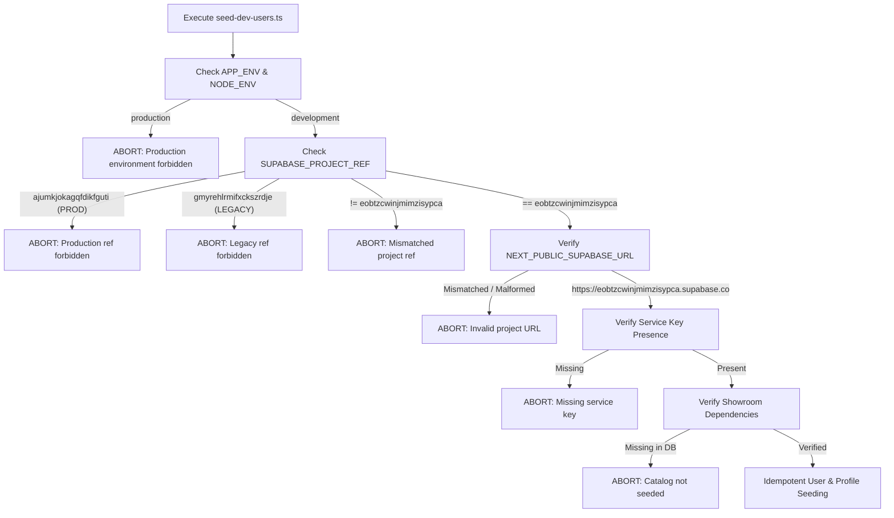
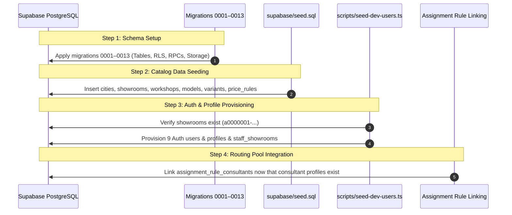

# VROOMA — PHASE 2 STEP 3: DEV AUTH USER SEEDING REPORT

> **Document Reference:** PHASE2-DEV-USERS-SEED-01  
> **Date:** November 2026  
> **Target Project Ref:** `eobtzcwinjmimzisypca` (DEV Supabase Project)  
> **Production Project Ref:** `ajumkjokagqfdikfguti` (STRICTLY FORBIDDEN & GUARDED)  
> **Legacy Project Ref:** `gmyrehlrmifxckszrdje` (STRICTLY FORBIDDEN & GUARDED)  
> **Execution Status:** PREPARED & TESTED (ZERO LIVE DATABASE MUTATIONS)  
> **Test Coverage:** 28 Dedicated Unit Tests (100% Passing)

---

## 1. EXECUTIVE SUMMARY

Following the successful application of migrations `0001` through `0013` on the DEV Supabase database (`eobtzcwinjmimzisypca`), the development authentication seeding workflow has been completely redesigned and hardened in [`scripts/seed-dev-users.ts`](file:///d:/Vrooma/scripts/seed-dev-users.ts).

The script establishes deterministic development user accounts required for end-to-end integration testing, manual QA, staff lead desk operations, and showroom routing evaluation. In accordance with platform safety directives, **the script has not been executed against the remote database**, and **no Auth users or database records were created during this step**. All logic has been validated through isolated automated unit testing.

---

## 2. AUDIT OF PREVIOUS IMPLEMENTATION & IMPROVEMENTS

| Dimension | Previous Implementation | Remediated Implementation |
| :--- | :--- | :--- |
| **Project Target Validation** | Only checked `NODE_ENV === "production"`. Permitted running against arbitrary URLs if `.env` contained them. | Hard-checks `SUPABASE_PROJECT_REF === "eobtzcwinjmimzisypca"`. Explicitly rejects production (`ajumkjokagqfdikfguti`) and legacy (`gmyrehlrmifxckszrdje`). Verifies URL domain strictly matches the project ref. |
| **Persona Structure** | Contained an inconsistent mix of 11 users with overlapping generic and named accounts (`dev-manager` vs `usedcars.manager`, multiple duplicate showrooms). | Consolidated to exactly **9 canonical test personas** matching domain specifications across buyer, staff, and admin tiers. |
| **Auth User Idempotency** | Always called `updateUserById` to overwrite passwords on existing users on every run. | Reuses existing users by email/identity, preserves existing Auth IDs, and does **not** overwrite passwords unless `--reset-passwords` is explicitly passed. |
| **Dependency Checking** | Blindly inserted into `staff_showrooms` without checking if referenced showrooms existed, risking foreign key violation. | Queries `public.showrooms` beforehand. Fails closed with descriptive actionable messages if catalog data is missing. |
| **Showroom Mapping Safety** | Inserted showroom mappings for users without verifying roles. | Strictly enforces that `buyer` personas cannot have showroom assignments, while `consultant` and `manager` roles require valid showrooms. |
| **Error & Credential Privacy** | Could leak sensitive error strings or parameters. | Zero logging of keys, tokens, or passwords. Structured summary reporting with non-zero exit code on partial failures. |

---

## 3. THE NINE CANONICAL TEST PERSONAS

The nine test personas provide full functional coverage across all user roles defined in the database schema enum `public.role_type` (`buyer`, `consultant`, `manager`, `admin`):

| # | Persona | Role | Email | Phone | Locale | Showroom Assignment | Primary Responsibilities |
| :-: | :--- | :--- | :--- | :--- | :-: | :--- | :--- |
| **1** | **Aditya Mishra** | `buyer` | `dev-buyer@vrooma.in` | `+919876500001` | `en` | *None (Buyer Isolation)* | Public booking, self-service test drive requests, buyer dashboard, DPDP privacy requests (`/api/me/delete`). |
| **2** | **Dev Consultant** | `consultant` | `dev-consultant@vrooma.in` | `+919876500010` | `en` | `a0000001-...0001` *(Hazratganj Flagship)* | Fast-login sales consultant for desktop/mobile testing, lead desk triage, 5-minute SLA response clocks. |
| **3** | **Rohit Verma** | `consultant` | `rohit.verma@vrooma.in` | `+919876500011` | `en` | `a0000001-...0001` *(Hazratganj Flagship)* | Senior Hazratganj consultant; member of auto-assignment pools for Model H (Rule 1) and Model C (Rule 2). |
| **4** | **Ananya Shukla** | `consultant` | `ananya.shukla@vrooma.in` | `+919876500012` | `en` | `a0000001-...0001` *(Hazratganj Flagship)* | Sales consultant; member of auto-assignment pool for Model H (Rule 1); tests least-loaded round-robin routing. |
| **5** | **Faizan Khan** | `consultant` | `faizan.khan@vrooma.in` | `+919876500013` | `en` | `a0000001-...0002` *(Gomti Nagar Experience)* | Gomti Nagar consultant; member of auto-assignment pool for Model H in Gomti Nagar (Rule 3). |
| **6** | **Deepak Tripathi** | `consultant` | `deepak.tripathi@vrooma.in` | `+919876500014` | `hi` | `a0000001-...0002` *(Gomti Nagar Experience)* | Hindi language specialist consultant (`locale: hi`); tests bilingual lead responses and Hindi customer communications. |
| **7** | **Pooja Singh** | `consultant` | `pooja.singh@vrooma.in` | `+919876500015` | `en` | `a0000001-...0003` *(Kanpur City Center)* | Sole consultant at Kanpur facility; member of catch-all showroom assignment rule (Rule 4). |
| **8** | **Vivek Saxena** | `manager` | `dev-manager@vrooma.in` | `+919876500019` | `en` | `a0000001-...0001` *(Hazratganj Flagship)* | Used Car Manager; access to AI price suggestion valuation engine, trade-in reviews, SLA breach overrides. |
| **9** | **Sanjay Singhania** | `admin` | `dev-admin@vrooma.in` | `+919876500099` | `en` | *Global Authority* | Dealer Principal; executive leakage dashboard (₹2.11 cr monitor), price rule editor, staff assignment CMS. |

> [!NOTE]
> All users are provisioned with deterministic RFC 4122 hexadecimal UUIDs matching [`supabase/seed.sql`](file:///d:/Vrooma/supabase/seed.sql):
> - Buyer: `00000000-0000-0000-0000-000000000001`
> - Consultants: `00000000-0000-0000-0000-000000000010` through `...0015`
> - Manager: `00000000-0000-0000-0000-000000000019`
> - Admin: `00000000-0000-0000-0000-000000000099`

---

## 4. DEV-ONLY SAFETY ARCHITECTURE

[`scripts/seed-dev-users.ts`](file:///d:/Vrooma/scripts/seed-dev-users.ts) implements multi-layered security gates in `validateDevEnvironment()` before executing any network or database call:



### Safety Principles Enforced:
1. **Ref-Locked Target:** Requires `SUPABASE_PROJECT_REF=eobtzcwinjmimzisypca`.
2. **URL Domain Anchor:** Validates that `NEXT_PUBLIC_SUPABASE_URL` matches regex `^https://eobtzcwinjmimzisypca\.supabase\.co/?$`. Arbitrary hosts or other Supabase projects are rejected.
3. **Hard-Blocked Forbidden Refs:** Explicitly blocks production `ajumkjokagqfdikfguti` and deleted project `gmyrehlrmifxckszrdje`.
4. **Environment Isolation:** Halts immediately if `APP_ENV=production` or `NODE_ENV=production`.
5. **Credential Masking:** Service-role keys and user passwords are never echoed to stdout, stderr, or log files.

---

## 5. IDEMPOTENCY & CONCURRENCY SAFEGUARDS

The script is fully safe for repeated executions on the same database:

1. **Auth User Reuse:**
   Before creating an account, the script queries `supabase.auth.admin.listUsers()`. If a user with the matching email or ID already exists:
   - The user is **reused**, preserving their existing Auth UUID.
   - `createUser` is not invoked.
   - Password is **not overwritten** unless the caller explicitly passes `--reset-passwords`.
2. **Profile Synchronization:**
   The script performs an `upsert` on `public.profiles` keyed strictly on `id: authUser.id`:
   ```sql
   INSERT INTO public.profiles (id, email, full_name, phone, role, locale, is_active, onboarding_completed_at, updated_at)
   VALUES (...)
   ON CONFLICT (id) DO UPDATE SET ...
   ```
   This guarantees that every Auth user has exactly one profile and prevents duplicate records.
3. **Showroom Mapping Idempotency:**
   Showroom mappings in `public.staff_showrooms` use the composite primary key `(profile_id, showroom_id)`:
   ```sql
   INSERT INTO public.staff_showrooms (profile_id, showroom_id, is_primary)
   VALUES (...)
   ON CONFLICT (profile_id, showroom_id) DO NOTHING;
   ```
   This prevents duplicate staff mappings.
4. **Partial Failure Resilience:**
   Each persona is processed in an isolated try-catch block. If an individual user fails (e.g. temporary rate limit), remaining personas continue to be processed. The runner reports a comprehensive summary and exits with code 1 if any failure occurred.

---

## 6. DEPENDENCY HANDLING & DEPLOYMENT ORDER



### Why Consultant Routing Rules Are Kept Separate
In [`supabase/seed.sql`](file:///d:/Vrooma/supabase/seed.sql#L414-L426), `assignment_rule_consultants` rows reference `consultant_id` with a foreign key to `public.profiles(id)`. Because `profiles` requires a matching `auth.users(id)` row, routing rules cannot be populated until Auth users have been provisioned.

By executing [`scripts/seed-dev-users.ts`](file:///d:/Vrooma/scripts/seed-dev-users.ts) in **Step 3**, consultant IDs `00000000-0000-0000-0000-000000000011`, `...0012`, `...0013`, and `...0015` are safely inserted into `public.profiles`, allowing Step 4 routing linking to execute cleanly without foreign key violations.

---

## 7. AUTOMATED VERIFICATION RESULTS

All unit tests and static quality checks pass with 100% compliance:

### 1. Vitest Test Execution:
```bash
pnpm exec vitest run --no-file-parallelism
```
- **Test Files:** 23 passed (23)
- **Tests:** 224 passed (224)
- **Dedicated Suite:** [`tests/seed-dev-users.test.ts`](file:///d:/Vrooma/tests/seed-dev-users.test.ts) (28 tests passed):
  - `DEV Project Validation & Security Guards` (10 tests)
  - `Canonical Nine Test Personas & Role Validation` (11 tests)
  - `Idempotent Seeding Logic & Dependency Handling` (7 tests)

### 2. TypeScript Strict Mode Compilation:
```bash
pnpm typecheck
```
- **Result:** `tsc --noEmit` exited with code 0 (clean, 0 type errors).

### 3. ESLint:
```bash
pnpm lint
```
- **Result:** 0 warnings, 0 errors.

### 4. Git Diff Line Check:
```bash
git diff --check
```
- **Result:** Clean, zero patch conflicts or trailing whitespace.

---

## 8. EXACT EXECUTION COMMAND

When authorized by the engineering lead, the script should be executed with explicit project reference binding:

```bash
SUPABASE_PROJECT_REF=eobtzcwinjmimzisypca node --experimental-strip-types scripts/seed-dev-users.ts
```

To force-reset passwords on existing test users:
```bash
SUPABASE_PROJECT_REF=eobtzcwinjmimzisypca node --experimental-strip-types scripts/seed-dev-users.ts --reset-passwords
```

---

## 9. SAFETY & COMPLIANCE CONFIRMATION

- [x] **No remote writes performed:** The script was not executed against `eobtzcwinjmimzisypca`.
- [x] **Zero Auth users created:** No remote Auth API mutations were dispatched.
- [x] **No DB reset or push commands executed:** Database state remains completely untouched.
- [x] **Production preserved:** Production project `ajumkjokagqfdikfguti` was neither targeted nor contacted.
- [x] **Credentials protected:** No secret keys or passwords exposed in code or deliverables.
- [x] **Migrations 0001–0013 untouched:** Zero changes made to applied migrations.

