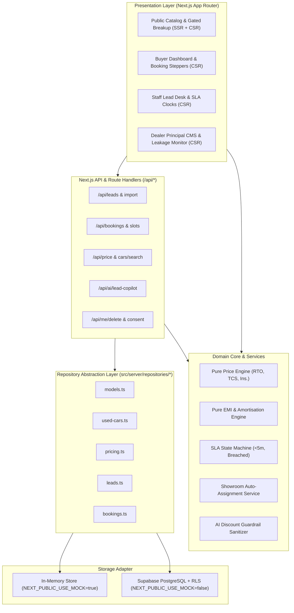
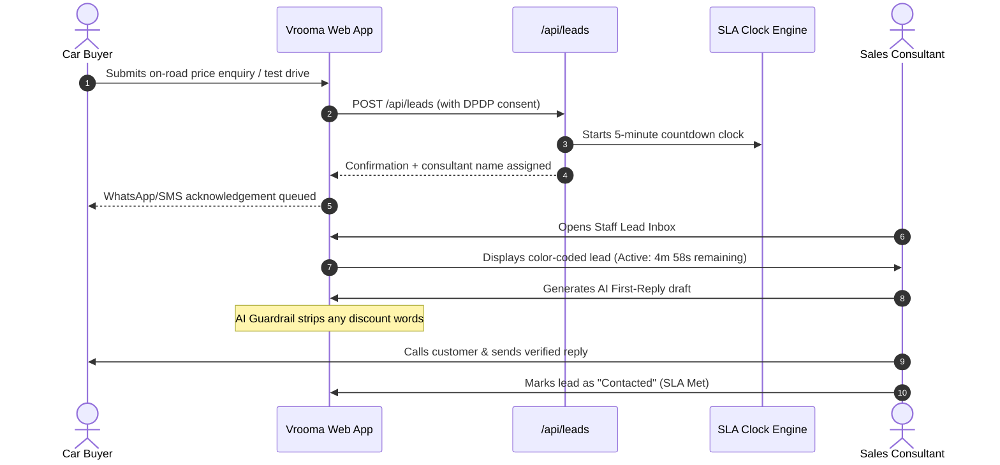

# VROOMA — SYSTEM ARCHITECTURE

## 1. High-Level Architecture

Vrooma is designed as a modular, high-performance automotive dealership platform built on Next.js 15 App Router, TypeScript, and a repository-based persistence abstraction that supports zero-code-change switching between in-memory mock storage and Supabase PostgreSQL.



---

## 2. Mock-to-Supabase Swap Pattern

The entire data access layer is abstracted behind pure TypeScript interfaces in `src/server/repositories/`. No frontend page or API route communicates directly with a database driver.

### Persistence Switch Flag
The active adapter is controlled by a single environment variable:
```env
NEXT_PUBLIC_USE_MOCK=true # or false for live Supabase
```

### Repository Implementation Architecture
```typescript
// Example: src/server/repositories/leads.ts
import { env } from "@/lib/env";
import { getMockStore } from "@/server/store";
import { createServerClient } from "@/lib/supabase/server";

export async function getLeads(): Promise<Lead[]> {
  if (env.NEXT_PUBLIC_USE_MOCK) {
    return getMockStore().getLeads();
  }
  const supabase = await createServerClient();
  const { data, error } = await supabase.from("leads").select("*");
  if (error) throw error;
  return data;
}
```

This guarantees:
1. Complete offline capability and immediate boot time during frontend development and automated unit testing.
2. 100% decoupling between UI state machines and database schemas.
3. Clean zero-regression migration to production Supabase by configuring connection credentials in `.env.local`.

---

## 3. Data Flow & Lead SLA Lifecycle



---

## 4. Security & DPDP Isolation

1. **Personal Data Masking:** Registration plates on pre-owned cars are permanently masked in public repository queries (`src/lib/masking.ts`).
2. **Consent & Erasure:** All customer forms capture explicit consent metadata (IP address, timestamp, terms version). Deletion requests immediately wipe lead records and dissociate past bookings via `/api/me/delete`.
3. **Role-Based Row Level Security (RLS):**
   - Public: Read-only access to published models, active price rules, and public stock.
   - Buyer: Read/write only on their own user ID.
   - Staff: Read/write on leads assigned to their designated showroom.
   - Admin / Used-Car Manager: Full access across catalogs and AI price recommendations.

