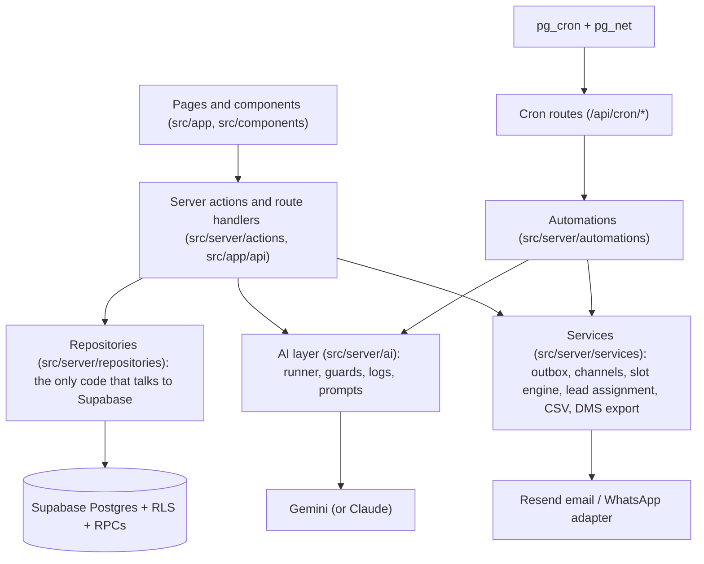

# VROOMA — SYSTEM ARCHITECTURE

Next.js 15 App Router (React 19, TypeScript strict) on Vercel, Supabase (Postgres with RLS, Auth, Storage, Realtime, pg_cron) as the only backend, Resend for email, Google Gemini (free key) for AI. The in-memory mock store and `NEXT_PUBLIC_USE_MOCK` no longer exist; the mock data in `src/data/mock/` only seeds `supabase/seed.sql` and unit tests.

## Layers
- **Pure domain code in `src/lib/`**: price engine, EMI, SLA, masking, money, phone, dates (`istDateString`), analytics, discount validation. No I/O, fully unit tested.
- **Repositories** return typed data; pages and actions never import the Supabase client directly. Types come from `src/types/database.types.ts` (generated).
- **Server actions** validate with `zod`, check the role (`requireRole`), call repositories/services, and return typed results. Destructive or sensitive actions write `audit_log`.
- **Services**: `outbox` (queue, retry, dead-letter), `channels` (`NOTIFY_CHANNEL` picks email or WhatsApp), `slot-engine`, `lead-assignment`, `csv-import`, `dms-export`, `chat-handoff`, `garage`.
- **Automations** (`src/server/automations`): reminders, outcomes, escalations, follow-ups, nudges, expiry alerts, garage reminders, digests. Each run writes a heartbeat; consent is checked at send time (`consent-gate`).
- **AI layer** (`src/server/ai`): everything goes through `runAi` (rate gate per minute, daily cap per feature, timeout, circuit breaker, redacted `ai_logs`). Output passes `guardAiText` (discount and price-promise filter, link and grounding checks). Without a key every feature falls back to rule-based text. See `docs/AI.md`.
- **Demo mode** (`src/lib/demo-mode.ts`, `demo-personas.ts`, `/api/auth/demo-login`): off unless `DEMO_LOGIN=true`.

## Lead lifecycle
Buyer submits (consent captured) → `create_lead` RPC routes by showroom and model, starts the 5-minute SLA → acknowledgement queued in the outbox → consultant opens the Lead Desk, sees the AI briefing, edits a guarded draft, replies → status moves, SLA met. A cron breach check flags leads past SLA and escalates (`automations/escalations`).

## Data and scheduling
Schema, retention and tables: `docs/DATA_MODEL.md`. Cron jobs (pg_cron calling the HTTP routes with `CRON_SECRET`): `docs/backend/OPERATIONS.md`. Environments and migrations: `docs/backend/ENVIRONMENTS.md`.

## Security and privacy
Registration numbers masked in public queries (`src/lib/masking.ts`); RLS on every table; role checks in layouts, actions and RLS; consent and erasure flows (`docs/DPDP.md`); security model (`docs/backend/SECURITY.md`).
